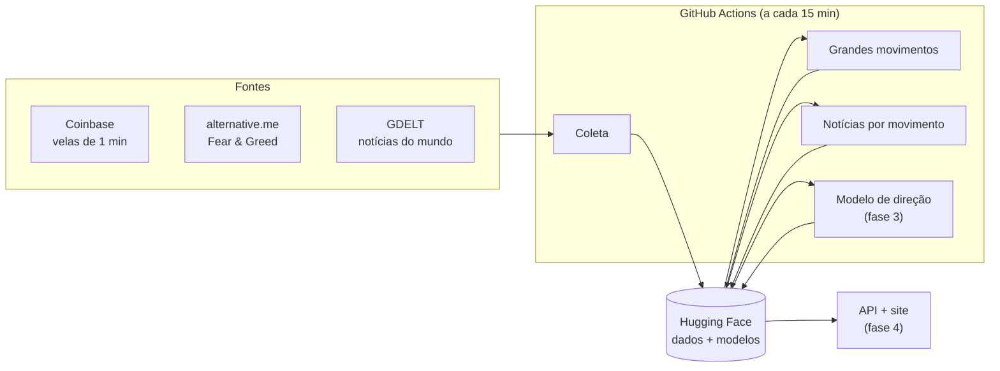

# Where Is My Crypto Going?

Previsão experimental da **direção do Bitcoin** (sobe ou desce) e análise das **notícias por
trás dos grandes movimentos**, com dados abertos, avaliação honesta contra referências
simples e tudo publicado de forma reprodutível.

> **Não é recomendação de investimento.** As previsões são experimentais, feitas para estudo
> e pesquisa. O preço de criptomoedas é muito volátil, e nenhum resultado passado garante
> resultado futuro.

## Autoria

**Victor Miranda Florido**

- Graduação em Ciência da Computação, Universidade Federal Fluminense (UFF)
- ORCID: [0009-0002-4580-2122](https://orcid.org/0009-0002-4580-2122)
- [Currículo Lattes](https://lattes.cnpq.br/6491049181958052)

Projeto irmão do [Future Space](https://github.com/Strutf/future-space) (DOI
[10.5281/zenodo.24119038](https://doi.org/10.5281/zenodo.24119038)), do qual reaproveita a
arquitetura de coleta e publicação.

## Perguntas

1. **Direção:** o preço do BTC daqui a 1 h, 4 h e 24 h estará acima ou abaixo do atual? O
   modelo responde com uma probabilidade, por exemplo "58% de chance de subir", e não só com
   "sobe" ou "desce".
2. **Tamanho:** quanto vai variar? É a segunda medida, que diz se a previsão chegou perto do
   que aconteceu.
3. **Notícias:** o que se noticiou **antes, durante e depois** de cada grande movimento? As
   notícias publicadas antes ajudam a prever a direção?

## Arquitetura

Mesmo esquema do Future Space, todo em planos gratuitos. Nenhum servidor roda continuamente.



**Granularidade e frequência:**

- **Dados de preço:** granularidade de 1 minuto. A Coinbase guarda o histórico de velas, então
  cada coleta busca todos os minutos desde a anterior, sem lacunas.
- **Coletas e previsões:** a cada 15 minutos, que é o ritmo do GDELT. Previsões a cada minuto
  exigiriam um servidor ligado o tempo todo, fora do esquema gratuito.

## Fases

| Fase | O que entrega | Situação |
|---|---|---|
| **1. Dados e grandes movimentos** | coleta do preço (1 min) e do Fear & Greed; detecção dos grandes movimentos; notícias de antes, durante e depois de cada um | **implementada** |
| 2. Mais variáveis | notícias e clima global ao vivo pelos arquivos brutos do GDELT; derivativos (financiamento, contratos em aberto); blockchain (mempool.space); macro (FRED) | planejada |
| 3. Modelo de direção | probabilidade de alta em 1 h, 4 h e 24 h, e retorno previsto; avaliação contra as referências | planejada |
| 4. API e site | previsões ao vivo, linha do tempo "o que moveu o Bitcoin", verificação pública | planejada |

## Fontes de dados (fase 1)

| Dataset | Fonte | O que fornece | Cadência | Cobertura |
|---|---|---|---|---|
| `btc-usd-1m` | [Coinbase Exchange](https://docs.cdp.coinbase.com/exchange/reference/exchangerestapi_getproductcandles) | abertura, máxima, mínima, fechamento e volume do BTC-USD | 1 min | jul/2015– |
| `fear-greed` | [alternative.me](https://alternative.me/crypto/fear-and-greed-index/) | índice de sentimento, de 0 (medo extremo) a 100 (ganância extrema) | 1 dia | fev/2018– |
| `big-moves` | este projeto | grandes movimentos detectados nas velas | evento | jul/2015– |
| `move-news` | [GDELT DOC 2.0](https://blog.gdeltproject.org/gdelt-doc-2-0-api-debuts/) | notícias em inglês sobre bitcoin e cripto em torno de cada movimento | evento | a depender da cobertura do GDELT |
| `gkg-hourly` | [GDELT GKG](https://www.gdeltproject.org/data.html#rawdatafiles) | notícias por hora: total, tom médio, as de bitcoin e as de assuntos do mundo (juros, bolsas, regulação, ataques hackers, guerras, sanções) | 1 h | fev/2015– |

Todas são gratuitas e não exigem cadastro.

A API ao vivo da Binance bloqueia endereços dos EUA, onde rodam os servidores do GitHub
Actions. Por isso, o preço vem da Coinbase, que tem histórico desde 2015.

## Metodologia

### Grandes movimentos

Um movimento na escala de *s* horas (1 h ou 24 h) termina na hora *t* quando a variação entre
*t − s* e *t* passa de **3 vezes a volatilidade típica**.

- **Volatilidade típica:** é o desvio-padrão dos retornos horários nos 30 dias que terminam no
  **início** do movimento, multiplicado por √*s*. Assim, nada do próprio movimento entra no
  limiar.
- **Agrupamento:** horas seguidas acima do limiar, no mesmo sentido, formam um único
  movimento, representado pela hora de maior variação relativa.
- **Por que um critério relativo:** "5% em um dia" era comum em 2018 e é raro hoje. Medir em
  vezes a volatilidade típica torna os períodos comparáveis.

### Notícias de cada movimento

Para cada movimento, o GDELT é consultado em três janelas:

| Fase | Janela | Interpretação |
|---|---|---|
| `before` | 24 h antes do início | candidatas a causa: o que interessa para prever |
| `during` | do início ao fim | notícia e preço reagindo juntos |
| `after` | 24 h depois do fim | em geral, a imprensa explicando o que já aconteceu |

Num teste com a queda de −14% de 05/02/2026, a maioria das manchetes do próprio dia
descrevia a queda ("crash accelerates", "what's going on?"). Separar as fases evita
confundir explicação a posteriori com causa.

**Categorias de causa** (por palavras-chave no título; uma notícia pode ter várias):

- macro (juros, inflação, Fed);
- regulação;
- ETF e fluxo institucional;
- segurança (hack, falência, fraude);
- geopolítica (guerra, sanções, acordos de paz, tarifas);
- liquidações e alavancagem.

**Movimentos sem notícia de causa** também são um resultado. Muitas quedas fortes vêm de
cascatas de liquidação de posições alavancadas. Os dados de derivativos da fase 2 servem para
identificá-las.

**Limites do GDELT:**

- aceita uma consulta a cada 5 s por IP e devolve 429 acima disso. A coleta espera 6 s entre
  consultas e 60 s depois de um 429;
- cada consulta traz até 250 notícias, as mais relevantes da janela;
- o horário registrado é quando o GDELT viu a notícia, que pode ser minutos depois da
  publicação.

**Duas formas de acesso ao GDELT:**

| Uso | Fonte | Por quê |
|---|---|---|
| Histórico dos grandes movimentos (fase 1) | API de busca (DOC 2.0), rodando localmente com paciência | buscar uma janela antiga nos arquivos brutos exigiria baixar ~700 MB por movimento |
| Notícias ao vivo (fase 2) | [arquivos brutos GKG](http://data.gdeltproject.org/gdeltv2/lastupdate.txt), a cada 15 min | são arquivos estáticos, sem limite de requisições |

A API de busca limita por IP. Num teste, este IP ficou bloqueado por vários minutos depois
de poucas consultas, e os servidores do GitHub Actions compartilham IPs. Por isso a coleta
ao vivo usa os arquivos brutos.

Nos arquivos brutos, as notícias de cripto vêm marcadas com o tema `ECON_BITCOIN`. Eles
também trazem os temas de todas as notícias do mundo, como conflito armado, desastre natural
e acordos de paz. Isso permite medir o "clima global" a cada 15 minutos como variável do
modelo.

### Avaliação planejada (fase 3)

- **Direção:** acerto, contra 50% e contra "repetir a última direção"; Brier e diagrama de
  confiabilidade para a probabilidade.
- **Tamanho:** MAE do retorno, contra o passeio aleatório (retorno zero) e contra a média
  histórica.
- **Volatilidade:** contra o GARCH, o modelo clássico.
- **Cuidados:**
  - divisão temporal com validação andando para a frente;
  - avaliação em blocos não sobrepostos, para não contar a mesma janela várias vezes;
  - movimentos acima de um limiar avaliados à parte;
  - variáveis disponíveis só depois de publicadas: a vela só depois de fechada, a notícia só
    depois de vista pelo GDELT.
- **Verificação ao vivo diária**, com histórico público, como no Future Space.

### Lacuna conhecida no histórico de notícias por hora

O `gkg-hourly` tem duas origens, com as mesmas definições de assunto:

| Período | Origem | Situação |
|---|---|---|
| fev/2015 a 15/11/2026 | GDELT no Google BigQuery | **incompleto em cerca de um quarto das horas** |
| de 16/11/2026 em diante | arquivos brutos do GDELT, lidos pelo GitHub Actions | completo |

O GDELT publica dois arquivos a cada 15 minutos (notícias em inglês e notícias traduzidas). Em
várias horas, a cópia do BigQuery está sem um desses arquivos, quase sempre o de traduções, e a
hora fica com 10% a 20% menos notícias do que realmente houve. Nas horas em que o BigQuery tem
os 8 arquivos, a agregação dos arquivos brutos dá números idênticos aos dele.

- **Tamanho:** 26.748 das 101.789 horas (26,3%), pela comparação entre a contagem do BigQuery e
  o tamanho dos arquivos publicados (`python research/gkg_gaps.py`). É uma estimativa, não uma
  contagem.
- **Efeito:** as contagens do histórico estão subestimadas nessas horas, e as da coleta ao vivo
  não. Proporções (assunto ÷ total de notícias) sofrem menos que contagens brutas.
- **Marcação:** as colunas `en_files` e `translated_files` dizem quantos arquivos formaram cada
  hora (4 = completa). No histórico elas estão vazias, porque a cota gratuita do BigQuery acabou
  antes da consulta que as preencheria.
- **Conserto, ainda não feito:** refazer o histórico pelos arquivos brutos (7,2 TB).

## Como reproduzir

Requer Python 3.11 ou mais recente.

```bash
git clone https://github.com/Strutf/where-is-my-crypto-going.git
cd where-is-my-crypto-going
python3 -m venv .venv && source .venv/bin/activate
pip install -e ".[dev,hf]"

wimcg backfill btc-usd-1m --start 2015-07-20     # histórico de 1 min (demorado: ~20 mil requisições)
wimcg backfill fear-greed --start 2018-02-01
wimcg update                                     # dados recentes
wimcg moves                                      # detecta os grandes movimentos
wimcg news --limit 20                            # notícias dos 20 maiores movimentos pendentes
pytest -q
```

Os dados ficam em `./data`, em Parquet e JSON. As variáveis de ambiente são as mesmas do
Future Space (ver [`.env.example`](.env.example)).

## Licença

O código é distribuído sob a licença [MIT](LICENSE). Os dados mantêm os termos de cada fonte:

- Coinbase: dados de mercado públicos;
- alternative.me: uso livre com atribuição;
- GDELT: uso livre com citação. Os títulos das notícias pertencem aos veículos originais.
